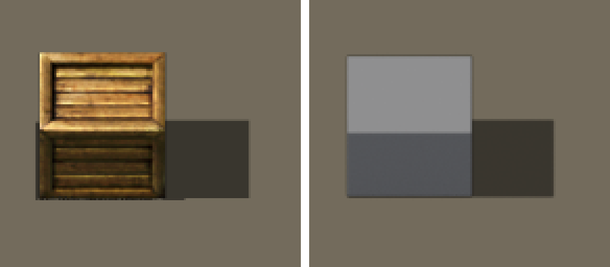
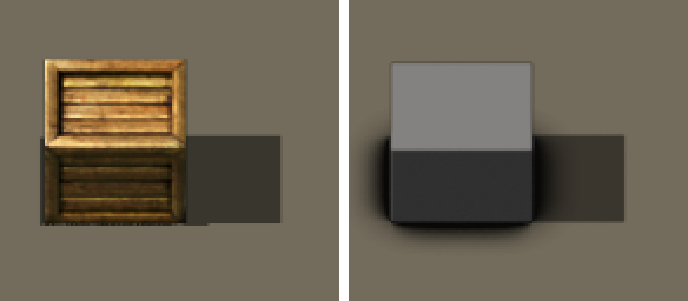
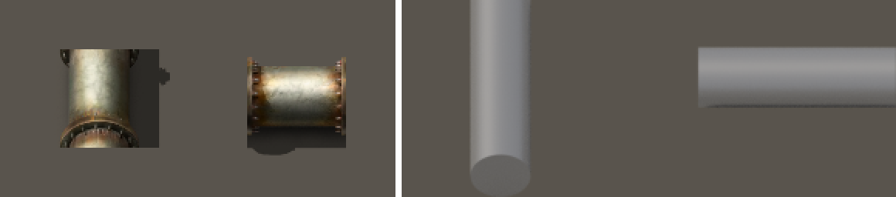
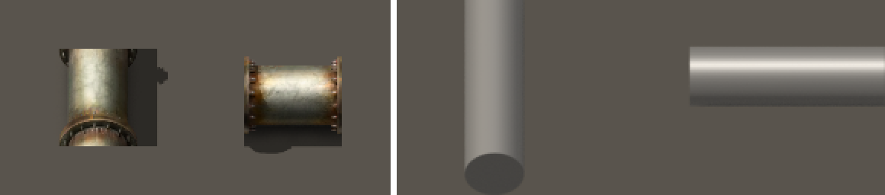
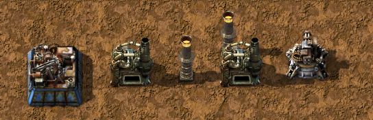
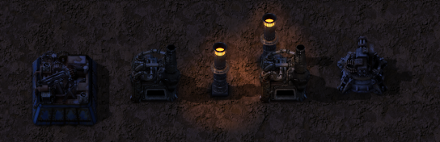
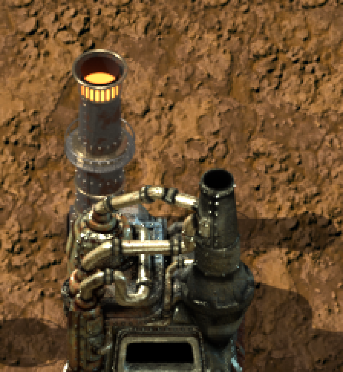
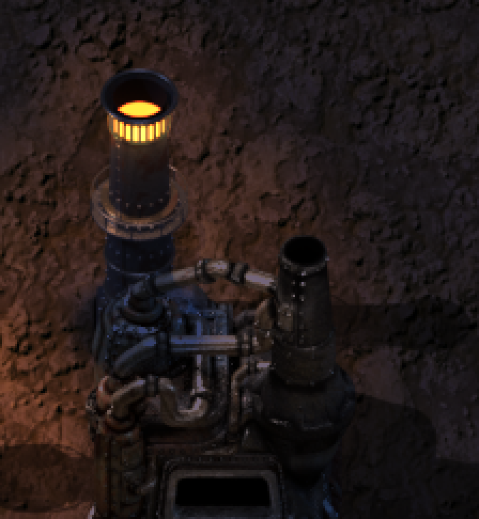
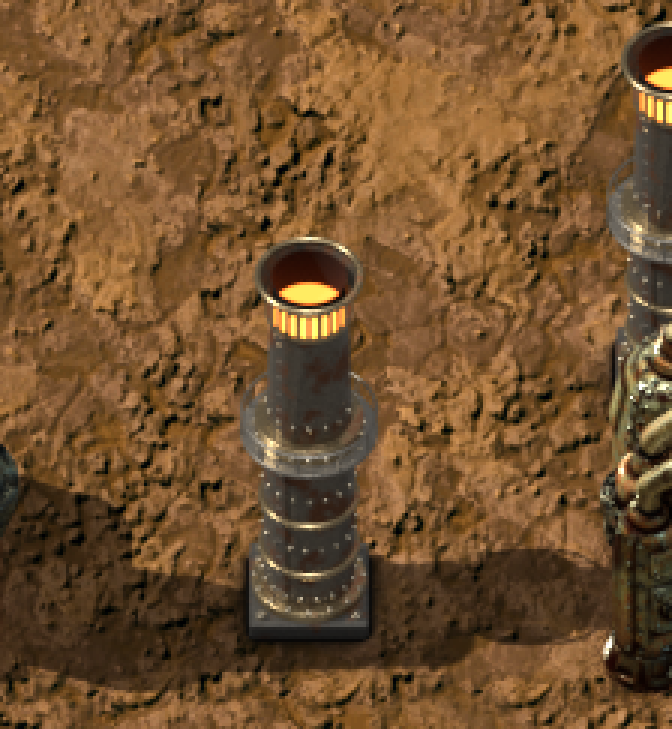

# Étalonnage du pipeline de rendu sur les sprites vanilla (lot V0, H-V1)

> Mesuré le 21/10/2026 sur les fichiers de Factorio 1.1.91 (`<racine>\data`), sans moteur.
> Reproduire : `python -P tools/render/calib/measure_vanilla.py "<racine>/data"` (mesures vanilla,
> sortie complète dans [calib/vanilla_mesures.txt](calib/vanilla_mesures.txt)) et
> `python -P tools/render/calib/run_calib.py "<racine>/data" --tag apres` (formes simples rendues et
> comparées). Constantes : [fo_calib.py](fo_calib.py). Toutes les tailles sont en pixels HR
> (64 px/tuile ; au zoom 1 le jeu les affiche à moitié).
>
> **Statut** : les chiffres ci-dessous sont des mesures. Le jugement visuel en jeu (captures jour/nuit,
> zooms 1 et 2) n'est **pas fait** : il revient au Directeur Créatif (OBJECTIFS D1 à D3).

## 1. Résumé

| Grandeur | Vanilla (mesure) | Rendu V0 avant réglage | Rendu V0 après | Réglage retenu |
|---|---|---|---|---|
| Échelle | tuile = 64 × 64 px HR | 64 × 64 | 64 × 64 (plaque d'une tuile : somme d'alpha 64,0 en largeur) | `PX_PER_UNIT_HR = 64` |
| Projection | caméra orthographique à 45°, sol non raccourci (§2) | — | brides 0,743 ; bouche 0,726 (même méthode de mesure) contre vanilla 0,707 à 0,742 et 0,737 | `THETA_DEG = 45` |
| Tuyau N-S / E-O | 39 / 38 px (rapport 0,97) | 40 / 39 | 40 / 39 | rayon 0,305 unité |
| Sphère | arc supérieur du dôme du labo : cercle, écart 0,62 px | — | dôme rendu : cercle de 64,02 px pour 64 | (projection orthographique) |
| Direction des ombres | plein est (pente −5,5° à +1,1°) | plein est | plein est | soleil à l'ouest, azimut 270° |
| Élévation du soleil | 47,6° à 50,3° (moyenne 48,7°) | 48° | 48° | `SUN_ELEV_DEG = 48` |
| Longueur d'ombre / hauteur à l'écran (poteaux) | 1,17 à 1,28 | 1,275 | 1,275 | — |
| Netteté des ombres | rampe 1 à 2 px, cœur alpha 1,0 | nette | nette | `SUN_ANGLE_DEG = 0` |
| Opacité affichée des ombres | alpha × 0,5 (shader du moteur) | — | couche noire, alpha 1 au cœur | — |
| IoU de l'ombre du coffre en bois | — | 0,940 | 0,941 | — |
| Façade sud / dessus (coffres, sRGB) | 0,356 (bois), 0,369 (fer), 0,398 (acier) | **0,588** | **0,368** | soleil 1,9 ; appoint zénithal 1,5 ; ciel 0,08 ; sol 0,15 |
| Profil du tuyau N-S (pic, en rayons) | −0,368 | −0,474 | **−0,368** | appoint zénithal |
| Profil du tuyau E-O (pic) | −0,459 | −0,368 | −0,421 | — |
| Corrélation des profils N-S / E-O | — | 0,918 / 0,874 | **0,981 / 0,970** | acier : métal 0,6, rugosité 0,5 |
| Liseré de contact (alpha, d = 1 à 10 px sous le bord) | 0,94 0,69 0,54 0,41 0,36 0,24 0,21 0,16 0,09 0,10 | aucun (0,96 0,27 0 …, simple anticrénelage) | 0,84 0,69 0,56 0,44 0,34 0,26 0,19 0,13 0,09 0,05 | AO à 0,38 unité, alpha = min(1 ; 5,5 × occlusion²) |
| Silhouette du coffre en bois (IoU) | — | 0,922 | 0,922 | (géométrie et ancrage) |

Images avant / après (gauche : vanilla, droite : rendu) :

| | Avant | Après |
|---|---|---|
| Coffre (sol, ombre affichée à 50 %) |  |  |
| Tuyaux |  |  |

## 2. Projection : comment le sol et la hauteur apparaissent

**Hypothèses comparées.**
- (A) image étirée verticalement après un rendu orthographique : les objets ronds sont ronds au rendu,
  puis l'image est étirée de 1/cos θ pour que le sol soit carré ;
- (B) caméra orthographique inclinée de θ, et grille de tuiles étirée en profondeur dans la scène.
  Les objets ronds restent ronds, et une tuile vers le sud mesure 1/cos θ unité.

**Mesures qui tranchent** (§2.1 à §2.3 de `vanilla_mesures.txt`) :
1. **Tuyaux.** Le tuyau nord-sud fait 39 px de large, le tuyau est-ouest 38 px d'épaisseur (alpha ≥ 0,98 ;
   40-41 px à 0,8, ombre portée comprise). (A) donnerait un tuyau est-ouest 1/cos θ plus épais, soit
   +41 % à 45°. **(A) est rejetée.** (B) donne 1,0.
2. **Cercles verticaux face caméra.** Arc d'une bride plate, rapport b/a attendu sin θ :
   - `pipe-to-ground-up` : 0,707 (écart 0,15 px) ;
   - `pipe-cover-south` : 0,729 ;
   - `pipe-cover-north` : 0,742 ;
   - `pipe-ending-down` : 0,739.

   Les bouchons bombés (0,80 à 0,86) sont exclus : le dôme dépasse la bride.
3. **Cercle horizontal.** Bouche de la cheminée du four en acier, ellipse complète : 0,735 à 0,741
   selon le seuil (écart 0,27 à 0,36 px). Le puits du silo, de forme irrégulière, donne 0,673 sur sa
   boîte englobante.
4. **Biais de la méthode, mesuré sur nos rendus à θ = 45° exactement** (vérité 0,7071) :
   - arc supérieur d'une cheminée : 0,726 ;
   - disque face caméra de 0,05 d'épaisseur : 0,743.

   La méthode surestime donc de +0,02 à +0,04. Les mesures vanilla (0,707 à 0,742 et 0,737)
   tombent dans cette fourchette pour θ = 45°. À θ = 48°, on attendrait 0,685 pour la bouche et 0,78 pour
   les brides.
5. **Sphère.** L'arc supérieur du dôme du labo s'ajuste à un cercle (écart 0,62 px) : la projection est
   orthographique, une sphère y reste un cercle. Notre dôme rendu donne un cercle de 64,02 px pour 64.
6. **Documentation du moteur.** Pour `RotatedSprite.apply_projection` (`prototype-api.json`), elle
   écrit : « the 45 degree angle for projection is used ».

**Retenu : θ = 45°, modèle (B).** Correspondance écran, en px HR relatifs à la position de l'entité :
- u = 64·X ;
- v = −64·(Y·cos 45° + Z·sin 45°).

Une tuile vers le sud vaut √2 = 1,414 unité Blender. Une unité de hauteur fait 45,25 px. Incertitude
sur θ : ±2° environ.

**Ancrage** (§2.4). Les bords opaques des bâtiments tombent sur les bords de leur emprise :
- bord bas : four 63 px pour 64, coffres 31 px pour 32, four en pierre 59 px pour 64 ;
- côtés : four −62 / +63 px ;
- le haut dépasse l'emprise (four −81, coffres −38/−39).

Notre convention : le sol Blender correspond exactement à la grille des tuiles, et l'origine est la
position de l'entité au sol. Le `shift` est calculé, multiple exact de 1/64. Vérifications :
- plaque d'une tuile rendue : 64 × 64 px, centrée ;
- coffre en bois reproduit (dessus 37 px, façade 31 px, bord avant à +30,5 px) : IoU 0,922 avec le
  sprite vanilla posé à son `shift`.

## 3. Lumière

### 3.1 Direction et élévation du soleil
- **Direction : plein est à l'écran.**
  - L'ombre du coffre en bois couvre en vertical −7 à +33 px, exactement la bande de contact au sol de la
    boîte (−6,5 à +30,5).
  - Le bout de l'ombre du petit poteau est à la hauteur de son pied (y = +9 et +9).
  - Je n'avais pas supposé de soleil au nord-ouest : l'azimut 270° (ouest pur) a été fixé d'emblée sur
    ces mesures.
  - Mesure indépendante de l'orchestrateur, reçue pendant le lot : pente de la ligne médiane des ombres
    d'objets verticaux de −5,5° à +1,1°, soit un cap de 84 à 91°. Détail : petit poteau +1,1°, moyen −5,5°,
    grand −2,2°, sous-station −1,5°, radar −3,5°. **Concordant.** L'orchestrateur précise que le
    décalage entre les barycentres de l'ombre et du corps (≈ 125°) vient de la hauteur du corps à l'écran,
    pas du soleil : il ne sert pas à caler l'azimut.
- **Élévation.** tan e = hauteur à l'écran / (longueur de l'ombre × sin 45°) :
  - petit poteau : 47,8° ;
  - poteau moyen : 50,3° ;
  - grand poteau : 49,0° ;
  - coffre en bois : 47,6°.

  Moyenne 48,7°, **retenu 48°**. Rapport longueur d'ombre / hauteur à l'écran :
  - vanilla : 1,17 à 1,28 (orchestrateur : 1,07 à 1,30) ;
  - rendu : 1,275.

  L'ombre de notre coffre fait 69 px de long, contre 71 (bois), 75 (fer) et 79 (acier) : ces coffres
  vanilla sont plus hauts que la boîte d'essai.

### 3.2 Ombres
- **Engine (fait, `data/core/graphics/shaders/shadow-a8.frag`).** `shadow = texture.w * 0.5`, couleur
  noire. Une ombre pleine assombrit donc le sol de 50 %.
- Les sprites d'ombre vanilla ont un cœur d'alpha 1,0, un RGB noir ou presque noir (gris + alpha, ou
  RGBA : `hr-iron-chest-shadow.png`, `hr-substation-shadow.png`) et une rampe d'anticrénelage de 1 à
  2 px seulement (§4.1).
- Rendu : sol attrape-ombre éclairé par le seul soleil, angle apparent 0, couche noire. Alpha = part
  d'ombre.

### 3.3 Équilibre des lumières (façades)
Médiane de luminance (sRGB) de la façade sud divisée par celle du dessus :
- vanilla : 0,356 (coffre en bois), 0,369 (fer), 0,398 (acier) ;
- premier essai (soleil 3,2, ciel uniforme 0,55, sol 0,22) : **0,588**, façades trop claires ;
- balayages (`calib/sweep.py`) :
  - ciel 0,05 / 0,12 / 0,20 : 0,416 / 0,451 / 0,483 ;
  - sol 0,08 / 0,12 / 0,16 : 0,308 / 0,348 / 0,384.
- retenu : ciel 0,08, sol 0,15, soit **0,368**. Dessus 0,509 pour un gris de 50 % (vanilla 0,455 à 0,504).

### 3.4 Appoint zénithal (profils des tuyaux)
- Avec le soleil seul à 48°, le reflet du tuyau nord-sud tombe à −0,47 rayon. Vanilla : −0,37.
- La lumière vanilla est donc plus zénithale sur les surfaces courbes, alors que les ombres disent 48°.
- Un **soleil zénithal sans ombre** (intensité 1,5, soleil principal ramené à 1,9) donne :
  - pic N-S à −0,368 (vanilla −0,368) ;
  - pic E-O à −0,421 (vanilla −0,459) ;
  - corrélation des profils de 0,981 (N-S) et 0,970 (E-O) ;
  - un rapport façade/dessus inchangé (0,363 à 0,368), car l'appoint vertical n'éclaire pas les façades.
- Acier de référence : métal 0,6, rugosité 0,5 (balayage : métal 0,3 / 0,6, rugosité 0,5 / 0,65).
- Écart restant : la luminance moyenne du tuyau rendu est 0,494, contre 0,425 en vanilla. C'est un choix de
  matériau par pièce.

## 4. Liseré de contact et couches lumineuses

### 4.1 Liseré
- **Vanilla.** Les sprites principaux des bâtiments (four en acier, four en pierre, assembleur 2,
  mitrailleuse, réservoir, labo) portent sous leur bord bas un liseré sombre semi-transparent. Alpha
  médian à d = 1…12 px : 0,943 0,691 0,541 0,405 0,357 0,244 0,208 0,155 0,093 0,104 0,057 0,047.
  Les coffres n'en ont pas.
- **Rendu.** Passe `ao` : occlusion ambiante limitée à 0,38 unité, de la pièce sur le sol. Alpha =
  min(1 ; 5,5 × occlusion²), couleur droite (0,035 ; 0,030 ; 0,025), composé sous la couche principale.
  Profil obtenu : 0,841 0,691 0,558 0,442 0,344 0,257 0,186 0,130 0,085 0,051 0,029 0,013. Écart maximal
  0,10 à d = 1, ≤ 0,05 au-delà.
- Balayage : portée 0,30 à 0,50, gamma 2 et 3, force 5,1 à 13.

### 4.2 Lueur et halo : formules du moteur
Fait, lu dans `data/core/graphics/shaders/game.frag` :

```
final = mix(LUT(couleur), couleur, clamp(lightmap) * lightMul + lightAdd)
```

- La nuit, la LUT est `core/graphics/color_luts/lut-night.png` (`utility-constants`, heures 0,45 à 0,55).
- `draw_as_glow` dessine le sprite normalement, puis dans la carte des lumières : visible de jour et
  de nuit.
- `draw_as_light` dessine dans la seule carte des lumières : il révèle la couleur de jour de ce qui est
  dessous.
- Disposition de la LUT, vérifiée : 16 tranches de bleu côte à côte, x = rouge, y = vert. La LUT
  identité rend l'entrée à 2·10⁻¹⁶ près.

Codage de nos couches additives (`blend_mode = "additive"`) :
- RGB = c / max(c), A = max(c), soit un prémultiplié égal à c ;
- correct en mode normal comme en additif ;
- aucune zone noire opaque.

Couleurs mesurées :
- **Lueur rendue** (cheminée seule) : moyenne prémultipliée (0,59 ; 0,31 ; 0,11), maximum (1,00 ; 0,62 ;
  0,25) ;
- **vanilla :**
  - feu du four `hr-steel-furnace-working.png` : max (1,00 ; 0,83 ; 0,24) ;
  - lumière au sol `hr-steel-furnace-ground-light.png` : prémultiplié max (0,79 ; 0,39 ; 0,04) ;
  - orchestrateur : lumières des fours orange de (99,49,3) à (241,144,2), en PNG couleur sans teinte.

Halo : éclairage direct seul de six sources ponctuelles devant la grille d'évents. Il est borné par deux
fenêtres circulaires :
- flaque au sol : pleine jusqu'à 1,1 tuile du pied, nulle à 2,1 tuiles ;
- cœur : autour des évents.

Une flaque compacte, comme `hr-steel-furnace-ground-light.png` (152 × 126 px).

## 5. Photométrie de la couche principale (pixels opaques, sRGB)

| Sprite | L moyenne | écart-type | p05 | p50 | p95 | saturation | grain |
|---|---|---|---|---|---|---|---|
| **Cheminée V0 (rendu final)** | **0,275** | **0,148** | **0,072** | **0,240** | **0,560** | **0,338** | **0,061** |
| four en acier | 0,236 | 0,201 | 0,015 | 0,181 | 0,661 | 0,355 | 0,064 |
| assembleur 2 | 0,251 | 0,196 | 0,032 | 0,194 | 0,660 | 0,404 | 0,057 |
| socle de mitrailleuse | 0,178 | 0,219 | 0,000 | 0,092 | 0,690 | 0,166 | 0,049 |
| réservoir | 0,329 | 0,192 | 0,073 | 0,285 | 0,668 | 0,381 | 0,036 |
| chaudière | 0,274 | 0,190 | 0,052 | 0,225 | 0,657 | 0,333 | 0,050 |
| radar | 0,271 | 0,177 | 0,071 | 0,225 | 0,658 | 0,296 | 0,055 |
| coffre en acier | 0,361 | 0,230 | 0,105 | 0,293 | 0,841 | 0,256 | 0,064 |
| poteau moyen | 0,277 | 0,230 | 0,000 | 0,231 | 0,738 | 0,523 | 0,082 |

Le grain est l'écart-type du passe-haut 3 × 3 de la luminance.

**Dans les plages vanilla** : luminance moyenne, médiane, p05, saturation, grain.

**Hors plage, défaut assumé et non corrigé** :
- écart-type 0,148 (vanilla 0,177 à 0,243) ;
- p95 0,560 (vanilla 0,657 à 0,847).

La cheminée a moins de reflets francs que les bâtiments vanilla. Cause probable : une pièce surtout
verticale, sans dessus plats éclairés par le soleil et l'appoint. Les cerclages en laiton ont fait
monter la saturation de 0,197 à 0,338, mais pas le p95. Pistes :
- plus de pièces horizontales claires (passerelle et lèvre en tôle claire) ;
- reflets d'arête plus vifs.

## 6. Maquette hors moteur

`calib/maquette.py` compose les fichiers livrés, avec leurs tailles et `shift` du manifeste, sur la
texture vanilla `hr-dirt-4.png` (rangées opaques 320 à 575). La composition suit l'ordre du moteur :
1. les ombres, au maximum des alphas, puis le sol × (1 − 0,5 × alpha) ;
2. les entités, triées par y puis x ;
3. la lueur, additive ;
4. la nuit : LUT `lut-night.png` et carte des lumières.

Scène : assembleur 2, four en acier, cheminée seule, four équipé de la cheminée, mitrailleuse.

| Zoom 1 jour | Zoom 1 nuit |
|---|---|
|  |  |

Gros plans ×3 au zoom 2 :
- four équipé, de jour : 
- four équipé, de nuit : 
- cheminée seule : 

Le zoom 2 complet est dans `tools/render/out/maquette/final/` (non versionné).

**Limites de la maquette, non prouvées hors moteur.**
- `lightMul` et `lightAdd` sont pris à 1 et 0.
- Le jeu ajoute une lumière ambiante de nuit, celle du joueur et la carte de détail.
- Le zoom 1 est une moyenne 2 × 2 des sprites HR, alors que le jeu filtre par mipmaps.
- La mitrailleuse est montée sans son masque de couleur de force.
- Les ombres sont combinées par maximum. Le mélange exact du tampon A8 du moteur n'est pas lu, et deux
  ombres pleines donnent 1 dans les deux cas.
